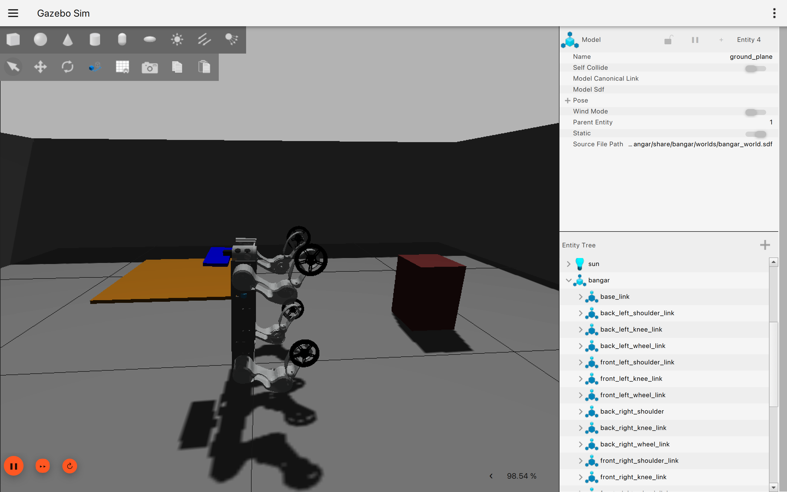
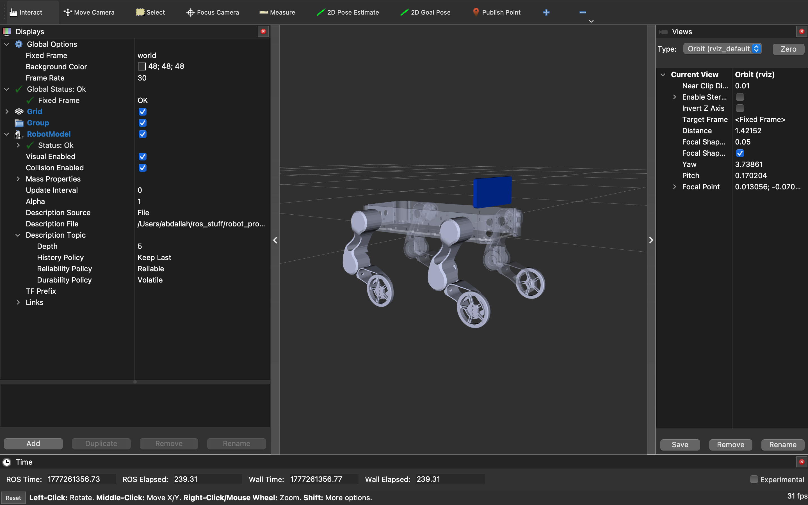
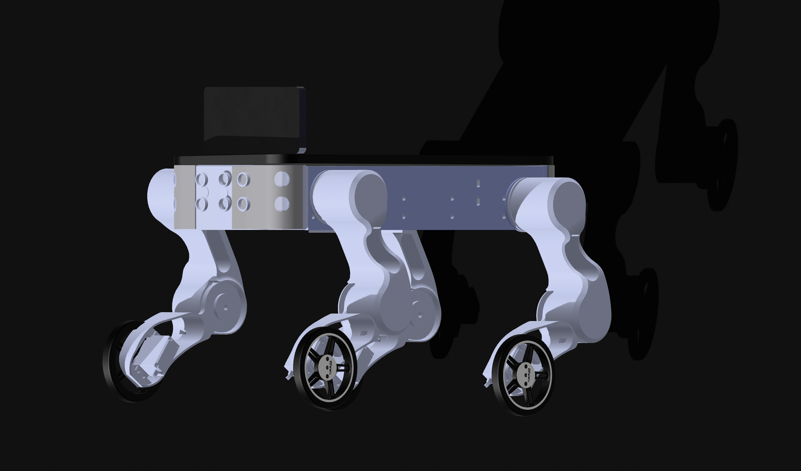

# Bangar Robodog (بانجار) 🐕⚙️

[](https://docs.ros.org/)
[](https://gazebosim.org/)
[](https://python.org)
[](LICENSE)

**Bangar** is a custom-designed **wheeled-quadruped robot dog** featuring hybrid legged and wheeled locomotion. Developed in **ROS 2** and simulated in **Gazebo Sim**, Bangar combines the rough-terrain clearance of quadruped trot gaits with the energy efficiency and agile turning of motorized wheels.

<p align="center">
  
  <br />
  <em>Conceptual design of Bangar as an assistive, domestic & warehouse companion robot.</em>
</p>

---

## 📸 Simulation & Design Showcase

| Gazebo Sim Warehouse Environment | RViz2 Kinematics & TF Model |
| :---: | :---: |
|  |  |
| **Gazebo Sim**: Physics simulation, custom friction zones, and obstacle arenas. | **RViz2**: Joint frames, links, acrylic chassis, and top phone mount. |

<p align="center">
  
  <br />
  <em>CAD rendering showing leg linkages, wheel assemblies, chassis acrylics, and sensor cutouts.</em>
</p>

---

## 🌟 Key Highlights

- **Hybrid Locomotion System:**
  - **Quadruped Trot Gait:** Diagonal pair trotting (FL+BR and FR+BL) with tuned shoulder sweeps and knee clearance arches.
  - **Continuous Wheeled Drive:** 4 powered wheels (Pololu 60×8mm) located at each foot for rapid flat-surface transit and zero-radius in-place yaw rotations.
  - **Dynamic Poses:** Dedicated sitting, standing, and stopping postures with smooth cosine-eased transitions.
- **Full Gazebo Sim (Harmonic / gz-sim) Integration:**
  - Position PID controllers for all 8 leg joints (shoulders and knees).
  - Velocity controllers for all 4 foot-mounted wheels.
  - Custom `warehouse_world.sdf` featuring a $30\text{m} \times 24\text{m}$ warehouse arena, color-coded navigation goals, and a low-friction terrain zone ($\mu = 0.2$) to evaluate traction.
- **Perception & Visual Odometry:**
  - Top chassis mount designed for a smartphone head unit.
  - Integration with DroidCam and OpenCV for real-time ArUco marker pose tracking and 2D map localization.
  - Topic bridges configured for multi-channel ultrasonic range sensing.

---

## 📐 Kinematics & Joint Architecture

Bangar possesses **12 actuated Degrees of Freedom (DoF)**:

| Joint Group | Joints | Type | Limits / Velocity | Actuator Role |
| :--- | :--- | :--- | :--- | :--- |
| **Shoulders (4×)** | `front_left_shoulder_joint`<br>`front_right_shoulder_joint`<br>`back_left_shoulder_joint`<br>`back_right_shoulder_joint` | Revolute | $\pm 0.8\text{ rad}$ ($50\text{ N}\cdot\text{m}$) | Forward/backward leg swing |
| **Knees (4×)** | `front_left_knee_joint`<br>`front_right_knee_joint`<br>`back_left_knee_joint`<br>`back_right_knee_joint` | Revolute | $\pm 1.2\text{ rad}$ / $\pm 1.4\text{ rad}$ | Leg lifting & ground clearance |
| **Wheels (4×)** | `front_left_wheel_joint`<br>`front_right_wheel_joint`<br>`back_left_wheel_joint`<br>`back_right_wheel_joint` | Continuous | Continuous ($10\text{ rad/s}$) | Driving & skid-steer turning |

---

## 📂 Repository Structure

```
bangar/
├── CMakeLists.txt              # Package build definitions & install targets
├── package.xml                 # ROS 2 package metadata and dependencies
├── README.md                   # Project documentation
├── .gitignore                  # Git exclusions for build artifacts
├── docs/
│   └── images/                 # Simulation screenshots and CAD renders
├── config/
│   └── joint_names_Bangar.yaml # Joint mappings configuration
├── launch/
│   ├── gazebo_launch.py        # Primary headless/macOS-safe Gazebo launch
│   ├── gazebo_walk.launch.py   # Gazebo simulation with walk controller
│   ├── display.launch.py       # Basic robot state display in RViz
│   └── rviz.launch.py          # Interactive RViz2 visualization
├── urdf/
│   ├── bangar.urdf             # Baseline URDF model
│   ├── bangar_gazebo.urdf      # Gazebo-optimized model with plugins & PIDs
│   └── bangar.csv              # Mass properties and link measurements
├── worlds/
│   └── warehouse_world.sdf     # Custom Gazebo simulation warehouse
├── meshes/                     # STL surface meshes for all links & wheels
└── bangar/                     # ROS 2 Python nodes
    ├── __init__.py
    ├── bangar_controller.py    # Master state machine controller
    ├── walk_node.py            # Diagonal trot gait generator
    ├── wheel_node.py           # Wheel velocity publisher
    ├── sit_node.py             # Cosine-interpolated sitting posture
    ├── turn_left_node.py       # Differential skid turn (left)
    ├── turn_right_node.py      # Differential skid turn (right)
    └── camera_node.py          # ArUco marker pose estimator via camera feed
```

---

## 🚀 Getting Started

### 1. Prerequisites

- **OS:** Linux (Ubuntu 22.04 / 24.04) or macOS (Apple Silicon / Intel via Conda/RoboStack)
- **ROS 2:** Jazzy Jalisco or Humble Hawksbill
- **Gazebo Sim:** Gazebo Harmonic or Fortress
- **ROS-Gazebo Bridge:** `ros_gz_bridge`, `ros_gz_sim`
- **Python Libraries:** `opencv-python`, `numpy`, `cv_bridge`

### 2. Workspace Setup & Build

Clone this package into your ROS 2 workspace's `src` folder:

```bash
# Create and navigate to your ROS 2 workspace
mkdir -p ~/ros2_ws/src
cd ~/ros2_ws/src

# Clone the repository
git clone https://github.com/AbdallahN-9/bangar-robodog.git bangar

# Install ROS dependencies
cd ~/ros2_ws
rosdep install --from-paths src --ignore-src -r -y

# Build with colcon
colcon build --symlink-install

# Source the overlay
source install/setup.bash
```

*(On macOS using zsh, use `source install/setup.zsh`)*

---

## 🕹️ Running the Simulation

### Option A: Launch Full Gazebo Simulation

To launch the complete simulation including physics server, robot spawn, topic bridges, and the high-level controller:

```bash
ros2 launch bangar gazebo_launch.py
```

*Tip for macOS users:* The launch file runs Gazebo server in headless mode (`-s`) by default for maximum stability across architectures.

### Option B: Interactive State & Motion Control

Once the Gazebo environment is running, command Bangar's behaviors on the `/bangar/mode` topic:

```bash
# Start walking (diagonal trot gait + forward wheel drive)
ros2 topic pub --once /bangar/mode std_msgs/msg/String "{data: 'walk'}"

# Turn left in place
ros2 topic pub --once /bangar/mode std_msgs/msg/String "{data: 'turn_left'}"

# Turn right in place
ros2 topic pub --once /bangar/mode std_msgs/msg/String "{data: 'turn_right'}"

# Sit down smoothly
ros2 topic pub --once /bangar/mode std_msgs/msg/String "{data: 'sit'}"

# Stand / Stop
ros2 topic pub --once /bangar/mode std_msgs/msg/String "{data: 'stop'}"
```

### Option C: View Kinematics in RViz2

To inspect the robot's URDF model and test gaits visually without physics:

```bash
ros2 launch bangar rviz.launch.py
```

### Option D: Vision & Marker Tracking

If utilizing a camera stream (e.g., via DroidCam at `http://<phone_ip>:4747/video`):

```bash
ros2 run bangar camera_node.py
```

---

## 📡 Key Topics & Bridges

| Topic | Type | Source | Purpose |
| :--- | :--- | :--- | :--- |
| `/joint_states` | `sensor_msgs/msg/JointState` | Gazebo Sim | Current angles & velocities of all 12 joints |
| `/bangar/mode` | `std_msgs/msg/String` | User / Teleop | Mode selector (`walk`, `turn_left`, `sit`, `stop`) |
| `/cmd/*_shoulder` | `std_msgs/msg/Float64` | `bangar_controller` | Commanded shoulder joint target angle (rad) |
| `/cmd/*_knee` | `std_msgs/msg/Float64` | `bangar_controller` | Commanded knee joint target angle (rad) |
| `/cmd/*_wheel` | `std_msgs/msg/Float64` | `bangar_controller` | Commanded wheel joint angular velocity |
| `/bangar/pose_estimate` | `geometry_msgs/msg/PoseWithCovarianceStamped` | `camera_node` | Visual pose estimated from ArUco markers |

---

## 👤 Author & Acknowledgments

- **Developer:** Abdallah ([@AbdallahN-9](https://github.com/AbdallahN-9))
- **Email:** [abdallah.alexcs@gmail.com](mailto:abdallah.alexcs@gmail.com)
- **CAD & Mechanical Design:** Modeled in SolidWorks with `SW2URDF`.

---

## 📄 License

This project is licensed under the [BSD-3-Clause License](LICENSE).
