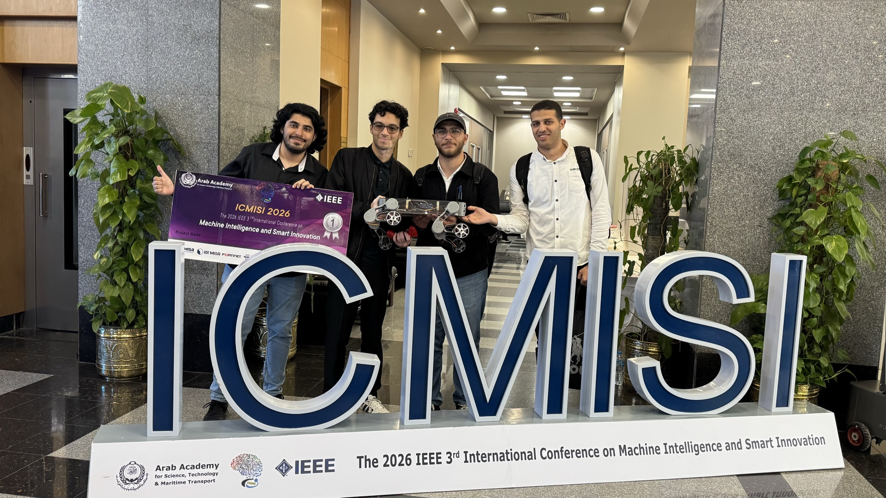
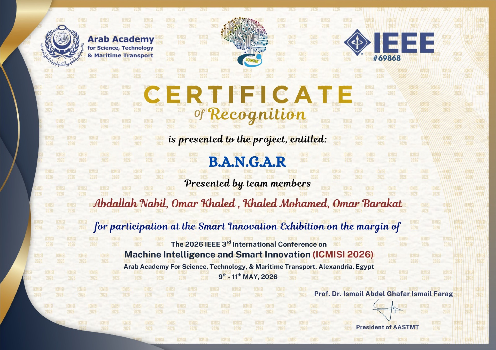
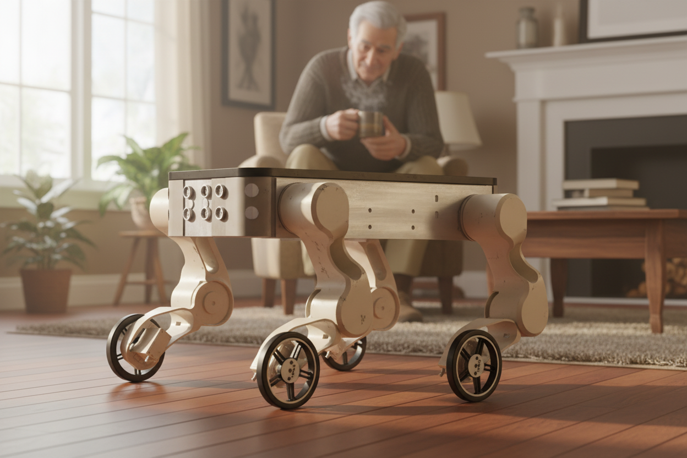
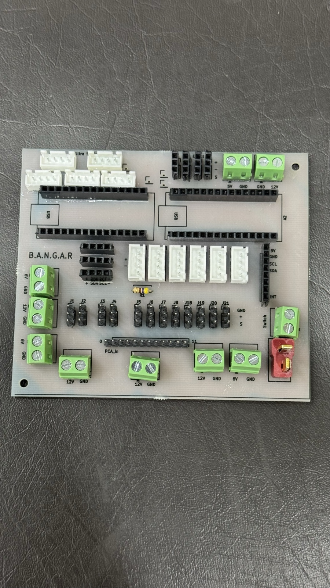
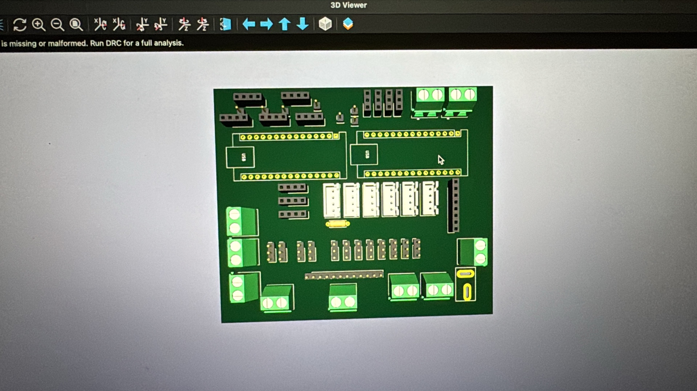
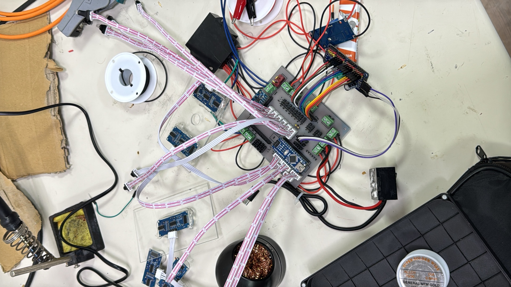
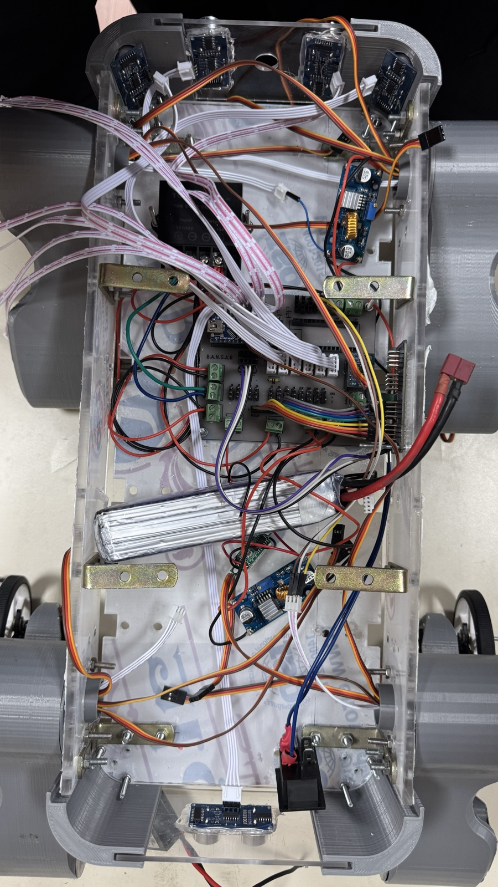

# Bangar Robodog (بنجر) 🐕⚙️

### An Assistive Wheeled-Quadruped Robot Dog: Custom Embedded Hardware, ROS 2 & Gazebo Simulation

[](https://docs.ros.org/)
[](https://gazebosim.org/)
[](https://kicad.org/)
[](https://www.ieee.org/)
[](LICENSE)

**Bangar** is an award-winning, custom-engineered **wheeled-quadruped robot dog** developed as an assistive, domestic companion robot. Designed to alleviate elderly loneliness and offer non-intrusive health/emergency monitoring, Bangar integrates custom embedded electronics, 12-DoF hybrid locomotion, and high-fidelity physics simulation in ROS 2 and Gazebo Sim.

---

## 👥 The Team & IEEE Recognition

Project Bangar was engineered by:

* **Abdallah Nabil** — *Electrical System & Gazebo Simulation*
* **Omar Khaled** — *Mechanical Design & Control Software*
* **Omar Barakat** — *Mechanical Assembly & Computer Vision*
* **Khaled Aboelmaety** — *Sensor Integration & System Debugging*

| IEEE ICMISI 2026 Exhibition & Award | IEEE Certificate of Recognition |
| :---: | :---: |
|  |  |
| The team showcasing Bangar at the 2026 IEEE 3rd International Conference on Machine Intelligence and Smart Innovation (ICMISI 2026). | **Official Recognition**: Presented by IEEE and the Arab Academy for Science, Technology & Maritime Transport (AASTMT). |

<p align="center">
  
  <br />
  <em>Concept: Bangar as an assistive companion in home living environments.</em>
</p>

---

## 🛠️ Custom Hardware, PCB & Wiring Integration

Bangar is powered by a custom-designed, multi-layer motherboard developed in **KiCad** ($107.25\text{ mm} \times 92.0\text{ mm}$) to handle power regulation, high-torque servo actuation, and distributed sensor processing:

| Fabricated Motherboard | KiCad 3D Component Layout |
| :---: | :---: |
|  |  |
| **Physical PCB:** Dual microcontroller sockets, screw power rails, blade fuse, and JST headers. | **3D CAD Layout:** Component placement, PCA9685 PWM headers, and terminal connectors. |

| Workbench Wiring & Sensor Testing | Full In-Chassis Electrical Integration |
| :---: | :---: |
|  |  |
| **Bench Testing:** Full testbench wiring with ultrasonic sensor arrays and dual Nano logic. | **Chassis Integration:** LiPo battery pack, buck converters, motherboard, and servo cabling. |

### Motherboard Architecture & Electronics Specifications

* **Processing & Logic:** Dual **Arduino Nano v3.x** microcontrollers for distributed motor control, kinematics timing, and sensor telemetry.
* **Actuator Control:** Dedicated 16-channel **PCA9685** 12-bit PWM servo controller interface (`PCA_In`) driving the 8 shoulder and knee servo motors (`J1`–`J8`, `J18`–`J21`).
* **Multi-Rail Power System:**
  * **12V High-Power Input/Output:** Screw terminal distribution for wheel drive motors and main battery input.
  * **6V High-Current Rail:** Dedicated high-amperage power distribution specifically tuned for the 8 high-torque leg servos.
  * **5V Logic Rail:** Regulated supply for microcontrollers, sensors, and logic lines.
  * **Circuit Protection:** Built-in automotive blade fuse holder and heavy-duty primary power toggle switch.
* **Sensors & Expansion Interfaces:**
  * Multi-channel **Ultrasonic Range Sensors** (`UltraS1`, `UltraS2`, etc.) via polarized JST connectors.
  * **Hall-Effect Wheel Encoders** (`Hall_Effect2`, `Hall_Effect3`) for wheel odometry and speed feedback.
  * **I2C Telemetry Bus:** Exposed SDA, SCL, 5V, GND, and INT breakout for IMU and expansion peripherals.
* **Fabrication Files:** Complete Gerber archives (`hardware/gerber/bangar_107.25x92.0mm_gerber.zip`) ready for direct manufacturing (JLCPCB, PCBWay, etc.).

---

## 📸 Simulation & Kinematics Showcase

| Gazebo Sim Warehouse Environment | RViz2 Kinematics & TF Model |
| :---: | :---: |
|  |  |
| **Gazebo Sim:** ODE physics, custom friction zones ($\mu=0.2$ to $\mu=50$), and navigation arenas. | **RViz2:** Joint coordinate frames, link geometry, acrylic chassis, and top phone mount. |

<p align="center">
  
  <br />
  <em>CAD render showcasing mechanical leg linkages, wheel assemblies, chassis cutouts, and smartphone mount.</em>
</p>

---

## 🌟 Key Locomotion & Software Features

- **Hybrid Legged-Wheeled Locomotion:**
  - **Quadruped Trot Gait:** Diagonal pair trotting (FL+BR in phase, FR+BL in antiphase) with coordinated shoulder sweeps and knee clearance arches.
  - **Differential Wheeled Drive:** 4 powered wheels (Pololu 60×8mm) located at the feet enable zero-radius in-place turns and fast flat-ground translation.
  - **Smooth Eased Poses:** Sitting, standing, and stopping postures generated via cosine easing interpolation.
- **Gazebo Sim Physics & Controllers:**
  - 8 Position PID controllers for shoulders ($P=150$) and knees ($P=40$).
  - 4 Velocity controllers for wheel driving ($P=10.0$).
  - Custom `warehouse_world.sdf` featuring a $30\text{m} \times 24\text{m}$ warehouse arena with colored navigation goals and a low-friction terrain zone ($\mu=0.2$) for traction testing.
- **Perception & Localization:**
  - Smartphone head bracket (`mobile_link`) with DroidCam IP stream integration.
  - Real-time ArUco fiducial marker tracking (`cv2.aruco`) for 2D world pose estimation.
  - ROS 2 message bridging for multi-directional ultrasonic proximity scanning.

---

## 📐 Kinematics & Joint Mapping

Bangar possesses **12 actuated Degrees of Freedom (DoF)**:

| Joint Group | Joints | Type | Limits / Range | Function |
| :--- | :--- | :--- | :--- | :--- |
| **Shoulders (4×)** | `front_left_shoulder_joint`<br>`front_right_shoulder_joint`<br>`back_left_shoulder_joint`<br>`back_right_shoulder_joint` | Revolute | $\pm 0.8\text{ rad}$ ($50\text{ N}\cdot\text{m}$) | Forward/rearward leg swing |
| **Knees (4×)** | `front_left_knee_joint`<br>`front_right_knee_joint`<br>`back_left_knee_joint`<br>`back_right_knee_joint` | Revolute | $\pm 1.2\text{ rad}$ / $\pm 1.4\text{ rad}$ | Leg lifting & ground clearance |
| **Wheels (4×)** | `front_left_wheel_joint`<br>`front_right_wheel_joint`<br>`back_left_wheel_joint`<br>`back_right_wheel_joint` | Continuous | Continuous ($10\text{ rad/s}$) | Driving & skid-steer turning |

---

## 📂 Repository Structure

```
bangar/
├── CMakeLists.txt              # Package build definitions & install targets
├── package.xml                 # ROS 2 package metadata and dependencies
├── README.md                   # Comprehensive project documentation
├── .gitignore                  # Git exclusions for build & temporary files
├── hardware/                   # Custom embedded electronics design
│   ├── kicad/                  # KiCad PCB project, schematic & layout files
│   └── gerber/                 # Ready-to-order manufacturing Gerber packages
├── docs/
│   └── images/                 # Simulation screenshots, PCB photos, wiring & CAD renders
├── config/
│   └── joint_names_Bangar.yaml # Joint names configuration
├── launch/
│   ├── gazebo_launch.py        # Complete headless/macOS-safe Gazebo launch
│   ├── gazebo_walk.launch.py   # Gazebo simulation with walk controller
│   ├── display.launch.py       # Basic robot state display in RViz
│   └── rviz.launch.py          # Interactive RViz2 visualization
├── urdf/
│   ├── bangar.urdf             # Baseline URDF model
│   ├── bangar_gazebo.urdf      # Gazebo simulation model with plugins & PIDs
│   └── bangar.csv              # Link masses, origins, and inertias
├── worlds/
│   └── warehouse_world.sdf     # Custom warehouse simulation arena
├── meshes/                     # STL geometry files for robot links & wheels
└── bangar/                     # ROS 2 Python nodes
    ├── __init__.py
    ├── bangar_controller.py    # Master state machine controller
    ├── walk_node.py            # Diagonal trot gait generator
    ├── wheel_node.py           # Wheel velocity publisher
    ├── sit_node.py             # Cosine-interpolated sitting motion
    ├── turn_left_node.py       # Differential skid turn (left)
    ├── turn_right_node.py      # Differential skid turn (right)
    └── camera_node.py          # ArUco marker pose estimator via camera feed
```

---

## 🚀 Getting Started

### 1. Prerequisites

- **OS:** Linux (Ubuntu 22.04 / 24.04) or macOS (Apple Silicon / Intel via Conda/RoboStack)
- **ROS 2:** Jazzy Jalisco or Humble Hawksbill
- **Gazebo Sim:** Gazebo Harmonic or Fortress (`gz-sim8`)
- **ROS-Gazebo Bridge:** `ros_gz_bridge`, `ros_gz_sim`
- **KiCad (Optional):** KiCad v7 or v8 (to view/edit PCB schematics)
- **Python Dependencies:** `opencv-python`, `numpy`, `cv_bridge`

### 2. Workspace Setup & Build

Clone into your ROS 2 workspace's `src` folder:

```bash
# Create and navigate to your ROS 2 workspace
mkdir -p ~/ros2_ws/src
cd ~/ros2_ws/src

# Clone the repository
git clone https://github.com/AbdallahN-9/bangar-robodog.git bangar

# Install ROS dependencies
cd ~/ros2_ws
rosdep install --from-paths src --ignore-src -r -y

# Build with colcon
colcon build --symlink-install

# Source the overlay
source install/setup.bash
```

*(On macOS using zsh, use `source install/setup.zsh`)*

---

## 🕹️ Running the Simulation

### Option A: Launch Full Gazebo Simulation

To launch the physics server, robot spawn, topic bridges, and behavioral controller:

```bash
ros2 launch bangar gazebo_launch.py
```

*Note for macOS users:* Gazebo server runs headless (`-s`) by default for optimal performance and stability.

### Option B: Interactive State & Motion Control

Command Bangar's locomotion modes on the `/bangar/mode` topic:

```bash
# Start walking (diagonal trot gait + wheel drive)
ros2 topic pub --once /bangar/mode std_msgs/msg/String "{data: 'walk'}"

# Turn left in place (differential wheel drive)
ros2 topic pub --once /bangar/mode std_msgs/msg/String "{data: 'turn_left'}"

# Turn right in place (differential wheel drive)
ros2 topic pub --once /bangar/mode std_msgs/msg/String "{data: 'turn_right'}"

# Sit down smoothly (cosine-interpolated rear leg fold)
ros2 topic pub --once /bangar/mode std_msgs/msg/String "{data: 'sit'}"

# Stand / Stop
ros2 topic pub --once /bangar/mode std_msgs/msg/String "{data: 'stop'}"
```

### Option C: View Kinematics in RViz2

To inspect the robot's URDF model and test gait movements visually without physics:

```bash
ros2 launch bangar rviz.launch.py
```

### Option D: Vision & Marker Tracking

To test ArUco marker pose localization from an IP phone camera feed:

```bash
ros2 run bangar camera_node.py
```

---

## 📡 Key Topics & Bridges

| Topic | Type | Source | Purpose |
| :--- | :--- | :--- | :--- |
| `/joint_states` | `sensor_msgs/msg/JointState` | Gazebo Sim | Current angles & velocities of all 12 joints |
| `/bangar/mode` | `std_msgs/msg/String` | User / Teleop | Mode selector (`walk`, `turn_left`, `sit`, `stop`) |
| `/cmd/*_shoulder` | `std_msgs/msg/Float64` | `bangar_controller` | Commanded shoulder joint target angle (rad) |
| `/cmd/*_knee` | `std_msgs/msg/Float64` | `bangar_controller` | Commanded knee joint target angle (rad) |
| `/cmd/*_wheel` | `std_msgs/msg/Float64` | `bangar_controller` | Commanded wheel joint angular velocity |
| `/bangar/pose_estimate` | `geometry_msgs/msg/PoseWithCovarianceStamped` | `camera_node` | Visual pose estimated from ArUco markers |

---

## 📄 License

This project is licensed under the [BSD-3-Clause License](LICENSE).
